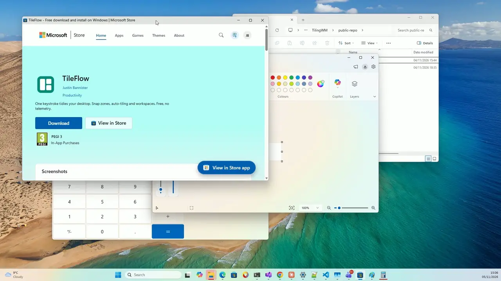

# TileFlow

**One keystroke turns a messy desktop into a clean grid.**

Snap zones, auto-tiling and workspaces for Windows 10 and 11, by mouse or keyboard.
Free. No telemetry. No account.

More clips: [keyboard shortcuts](media/shortcuts.mp4) · [drag-to-snap](media/drag-snap.mp4) · [auto-tiling](media/auto-tile.mp4)

## Install

[Get it from the Microsoft Store](https://apps.microsoft.com/detail/9P2Z97SJZJ46)

    winget install 9P2Z97SJZJ46 --source msstore

TileFlow runs from the system tray. To try it, press `Alt+Win+A`.

## What it does

- **Instant Workspace** (`Alt+Win+A`): arranges every open window into a grid.
- **Drag-to-snap**: drop a window on an edge or corner, and a live overlay shows where it will land.
- **Auto-tiling** (`Ctrl+Alt+Win+T`): master + stack, with `Ctrl+Alt+Win+J/K` to move focus.
- **Hotkeys that don't fight Windows**: `Alt+Win` and `Ctrl+Alt+Win` chords that avoid Windows 11's own shortcuts. Every one can be remapped, and if another app has taken one, TileFlow adds Ctrl automatically.
- **Plays nicely with Windows Snap**: while TileFlow's drag-to-snap is on, it pauses Windows' own drag-to-edge snapping so the two don't fire together, and turns it back on when you switch off or quit.
- **Light**: about 20 MB in Task Manager and ~0% CPU when idle.
- **Layouts**: Classic, Thirds and Ultrawide, adjustable gaps, and independent zones per monitor.
- **Pro: windows go back where they were** after docking, undocking, display changes or sleep.
- **Pro: Workspaces**: save an arrangement and restore it with `Ctrl+Alt+Win+1…9`, relaunching missing apps.
- **Pro: app rules and a zone editor**, plus one-click import of your PowerToys FancyZones layouts.

## Free vs Pro

| | Free | Pro ($9.99 once) |
|---|---|---|
| Drag-to-snap, hotkeys, built-in layouts, gaps | ✓ | ✓ |
| Auto-tiling, Instant Workspace, move to monitor | ✓ | ✓ |
| Multi-monitor | ✓ | ✓ |
| Restore windows after dock/undock/sleep | | ✓ |
| Saved Workspaces with app relaunch | | ✓ |
| App rules (pin apps to zones/monitors) | | ✓ |
| Zone editor + FancyZones import | | ✓ |

Pro is a one-time purchase, not a subscription. Both tiers are fine to use at work.

## How it compares

| | TileFlow | FancyZones (PowerToys) | GlazeWM | Komorebi |
|---|---|---|---|---|
| Drag-to-snap zones | ✓ | ✓ | – | – |
| Automatic tiling | ✓ | – | ✓ | ✓ |
| Mouse-first friendly | ✓ | ✓ | – | – |
| Restores windows after docking | ✓ (Pro) | – | – | – |
| Price | Free / $9.99 once | Free | Free | Free for personal use; paid license for work |
| Source | Closed | Open | Open (GPL-3.0) | Source-available |

If you live on the keyboard and want i3 on Windows, GlazeWM and Komorebi are excellent.
TileFlow is for people who want tiling without giving up the mouse.

## Privacy

- No network connections, analytics or telemetry. No account.
- The mouse hook only detects window drags toward screen edges. Input is never logged or stored.
- Window positions, titles and app paths are saved locally in `%AppData%\TileFlow` to restore
  workspaces. You can delete the folder any time.
- Cloud Sync is off by default. When you turn it on, it copies your settings to *your own* OneDrive
  folder. Nothing is sent to us.
- Full policy: [privacy](https://swevo.github.io/tileflow-privacy/)

## Share your layout

Post your setup in [Discussions → Layouts](../../discussions) with a screenshot.

## Feedback

Bugs and feature requests: [Issues](../../issues).
